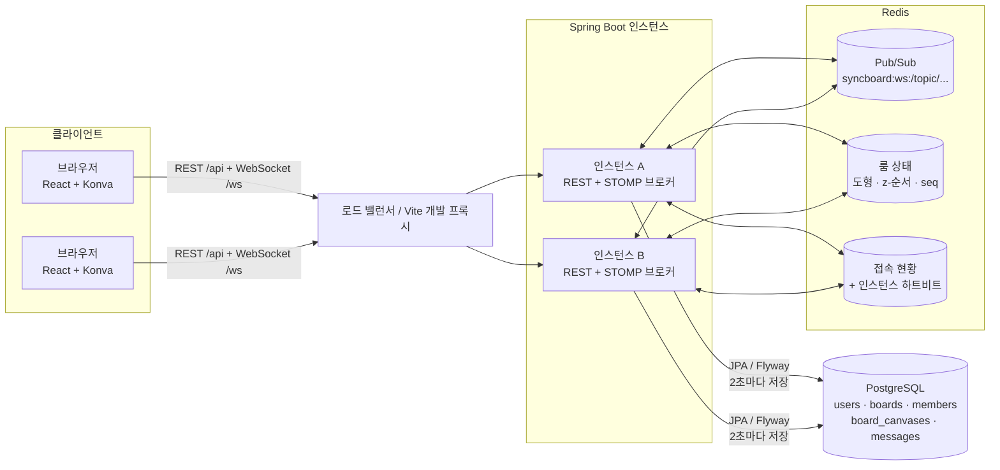
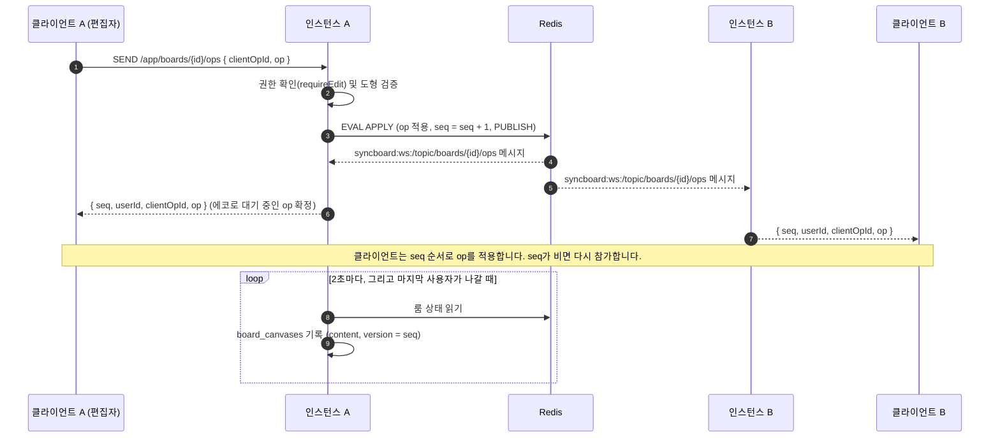

# SyncBoard

[English](README.md) | **한국어**

SyncBoard는 실시간 협업 화이트보드입니다. 여러 사람이 같은 보드에 동시에 그림을 그릴 수 있습니다. 서로의 변경 사항과 커서가 실시간으로 보이고, 보드마다 채팅도 있습니다. 보드는 **편집자** 또는 **뷰어**로 공유할 수 있습니다. 하나의 보드를 여러 백엔드 인스턴스가 함께 서비스할 수 있으며, 인스턴스 간 동기화는 Redis가 담당합니다.

<!-- TODO: 라이브 데모 URL로 교체 -->
**라이브 데모:** _준비 중_

## 스크린샷

<!-- TODO: docs/screenshots/에 스크린샷을 추가하고 아래 주석을 해제 -->
<!--


-->

_스크린샷 준비 중입니다._

## 주요 기능

- **계정:** 회원가입과 로그인을 지원합니다. 세션은 JWT 액세스 토큰을 사용합니다.
- **보드와 공유:** 보드를 만들고, 이름을 바꾸고, 삭제할 수 있습니다. 기존 사용자를 이메일로 `EDITOR` 또는 `VIEWER`로 초대하고, 역할을 바꾸거나 내보낼 수 있으며, 직접 보드에서 나갈 수도 있습니다. 대시보드에는 내가 만든 보드와 공유받은 보드가 함께 표시됩니다.
- **그리기 도구:** 선택/이동, 펜, 사각형, 타원, 직선, 텍스트, 지우개를 제공하며 선 색상과 두께를 고를 수 있습니다. **실행 취소**는 사용자별로 동작하며 다른 사람의 작업은 되돌리지 않습니다.
- **실시간 동기화:** 변경 사항이 밀리초 단위로 모두에게 전달됩니다. 서버가 모든 변경의 순서를 정하므로 모든 클라이언트가 같은 그림을 보게 되고, 오프라인 중 편집한 내용은 재연결 시 다시 전송됩니다.
- **접속 현황과 실시간 커서:** 누가 접속해 있는지 사용자별 고정 색상으로 보여 주고, 모두의 커서를 캔버스 위에 표시합니다.
- **채팅:** 보드별 채팅으로 기록, "입력 중…" 표시, 읽지 않은 메시지 수를 제공합니다. 뷰어도 채팅할 수 있습니다.
- **이동과 확대/축소:** 휠, 트랙패드 핀치 또는 확대/축소 컨트롤로 10%–400% 사이에서 확대/축소할 수 있습니다. Space+드래그 또는 마우스 가운데 버튼으로 이동하고, "내용에 맞추기"로 그림 전체를 볼 수 있습니다.
- **PNG 내보내기:** 그림 전체를 이미지로 내려받습니다. 확대/축소 배율과 관계없이 같은 이미지가 만들어집니다.
- **두 가지 언어:** 영어와 한국어 UI를 제공하며, API 오류 메시지도 두 언어로 제공됩니다.
- **수평 확장:** 로드 밸런서 뒤에서 여러 백엔드 인스턴스를 실행할 수 있으며, 스티키 세션이 필요 없습니다.

## 아키텍처

프론트엔드는 계정, 보드, 멤버, 채팅 기록에 REST(`/api`)를 사용합니다. 실시간 기능은 모두 STOMP WebSocket(`/ws`)으로 주고받습니다.

각 백엔드 인스턴스는 자신에게 연결된 WebSocket 클라이언트를 담당합니다. 공유되는 실시간 상태는 모두 **Redis**에 있습니다.

- 활성 룸(도형, z-순서, `seq`);
- 접속자 목록;
- 인스턴스 하트비트.

모든 브로드캐스트는 Redis Pub/Sub을 거치므로, 인스턴스 A에 연결된 클라이언트도 인스턴스 B를 통해 들어온 변경을 받습니다. 영구 저장소는 **PostgreSQL**입니다. 활성 룸은 2초마다, 그리고 마지막 사용자가 나갈 때 PostgreSQL에 기록됩니다.



### 그림 변경이 전달되는 과정

각 변경(`add`, `update`, `remove` op)은 새 도형 전체를 담고 있어서 멱등적입니다. Redis Lua 스크립트가 op를 룸에 적용하고, 다음 `seq` 번호를 붙이고, 발행하는 일을 하나의 원자적 단계로 처리합니다. 그래서 모든 인스턴스가 같은 순서로 op를 받습니다. 각 클라이언트는 한 번에 하나의 op만 전송합니다. 클라이언트는 확정된 상태 위에 아직 확정되지 않은 자신의 op를 겹쳐 보여 주고, 서버의 에코가 오면 확정합니다.



(재)연결하면 클라이언트는 `/app/boards/{id}/join`을 구독합니다. 응답에는 현재 스냅샷과 그 `seq`, 접속자 목록, 최근 채팅 메시지가 들어 있으며, 클라이언트는 이어서 대기 중인 op를 다시 보냅니다. 인스턴스가 죽으면 Redis의 하트비트 키가 만료되고, 다른 인스턴스가 그 인스턴스 사용자들을 접속자 목록에서 제거합니다.

## 기술 스택

| 영역 | 기술 |
| --- | --- |
| 백엔드 | Java 21, Spring Boot 3.5, Spring Web, Spring WebSocket (STOMP, simple broker), Spring Security + OAuth2 Resource Server (JWT, HS256, Nimbus), Spring Data JPA, Bean Validation, Maven |
| 데이터 | PostgreSQL, Flyway 마이그레이션, Redis (Pub/Sub, Lua 스크립트, 룸 상태, 접속 현황) |
| 프론트엔드 | React 19, TypeScript, Vite, React Router, Tailwind CSS v4, Konva + react-konva, @stomp/stompjs, i18next + react-i18next |
| 테스트 및 도구 | JUnit 5 + Spring Boot Test (실제 PostgreSQL과 Redis, STOMP 테스트 클라이언트), Vitest + Testing Library + jsdom, oxlint |

## 로컬 실행

### 사전 요구 사항

- **JDK 21**
- **Node.js 22** (Vite는 Node 20.19 이상에서도 동작)
- **PostgreSQL**
- **Redis.** Windows에서는 WSL에서 실행합니다.

  ```bash
  sudo apt install redis-server
  sudo systemctl enable --now redis-server
  redis-cli ping   # PONG
  ```

### 1. 데이터베이스 만들기

Flyway는 테이블은 만들지만 데이터베이스는 만들지 않습니다.

```bash
createdb -U postgres syncboard
createdb -U postgres syncboard_test   # 테스트용
```

### 2. 백엔드 설정

```bash
cd backend
cp .env.example .env
```

`backend/.env`를 채웁니다(Java `.properties` 형식, 따옴표 없음). 최소한 `DB_PASSWORD`와 `JWT_SECRET`은 설정해야 합니다. 시크릿은 32바이트 이상이어야 하며, 다음과 같이 만들 수 있습니다.

```bash
openssl rand -base64 48                                              # Bash
[Convert]::ToBase64String((1..48 | % { Get-Random -Max 256 }))      # PowerShell
```

| 변수 | 기본값 / 예시 | 용도 |
| --- | --- | --- |
| `DB_URL` | `jdbc:postgresql://localhost:5432/syncboard` | 앱 데이터베이스 |
| `DB_USERNAME` / `DB_PASSWORD` | `postgres` / — | 데이터베이스 계정 |
| `TEST_DB_URL` | `jdbc:postgresql://localhost:5432/syncboard_test` | 테스트 데이터베이스 |
| `REDIS_URL` | `redis://localhost:6379` | 앱용 Redis |
| `REDIS_TEST_URL` | `redis://localhost:6379/1` | 테스트용 Redis |
| `JWT_SECRET` | — | HS256 서명 키, 32바이트 이상 |
| `JWT_TTL` | `PT1H` | 액세스 토큰 유효 기간 (ISO-8601) |
| `CORS_ALLOWED_ORIGINS` | `http://localhost:5173` | 허용할 프론트엔드 출처 |

실제 환경 변수가 `.env`보다 우선합니다. 이 파일은 작업 디렉터리를 기준으로 읽히므로 Maven은 항상 `backend/`에서 실행하세요.

### 3. 백엔드 실행

```bash
cd backend
./mvnw spring-boot:run        # Windows PowerShell: .\mvnw.cmd spring-boot:run
```

API는 <http://localhost:8080>에서 실행됩니다. Flyway가 시작 시 마이그레이션을 적용합니다.

### 4. 프론트엔드 실행

```bash
cd frontend
npm install
npm run dev
```

<http://localhost:5173>을 엽니다. Vite 개발 서버가 `/api`와 `/ws`를 `localhost:8080`으로 프록시합니다.

### 여러 백엔드 인스턴스 실행 (선택)

같은 PostgreSQL과 Redis를 사용하는 두 번째 인스턴스를 다른 포트로 실행합니다.

```bash
./mvnw spring-boot:run -Dspring-boot.run.arguments=--server.port=8081
```

서로 다른 인스턴스에 연결된 클라이언트끼리도 그림, 커서, 접속 현황, 채팅이 공유됩니다.

## 테스트

### 백엔드

테스트는 실제 `syncboard_test` 데이터베이스와 Redis(데이터베이스 `/1`, 키 접두사 `syncboard-test`)를 사용하므로 둘 다 실행 중이어야 합니다. Testcontainers나 Docker는 사용하지 않습니다. 실시간 테스트는 실제 STOMP 클라이언트를 임의 포트의 서버에 연결하며, `MultiInstanceIntegrationTest`는 테스트 컨텍스트 옆에 두 번째 인스턴스를 띄웁니다.

```bash
cd backend
./mvnw test                                   # 전체 테스트
./mvnw test -Dtest=AuthServiceTest            # 클래스 하나
./mvnw test -Dtest=AuthServiceTest#loginWithWrongPasswordFailsWithoutIssuingToken   # 메서드 하나
```

### 프론트엔드

테스트는 jsdom에서 실행됩니다. WebSocket 연결과 Konva는 목(mock)으로 대체되고, `fetch`는 스텁으로 처리됩니다.

```bash
cd frontend
npm test                                      # Vitest 1회 실행 (감시 모드는 npm run test:watch)
npx vitest run src/pages/LoginPage.test.tsx   # 파일 하나, 테스트 하나는 -t "<테스트 이름>" 추가
npm run lint                                  # oxlint
npm run build                                 # 타입 검사 + 프로덕션 빌드
```

## 프로젝트 구조

```text
syncboard/
├── backend/                     Spring Boot API (com.syncboard)
│   └── src/main/
│       ├── java/com/syncboard/
│       │   ├── auth/            회원가입, 로그인, JWT
│       │   ├── user/
│       │   ├── board/           보드, 멤버, 권한 확인
│       │   ├── chat/            채팅 메시지와 기록
│       │   ├── realtime/        STOMP, 룸, 접속 현황, Redis 버스
│       │   ├── config/
│       │   └── common/          오류 처리
│       └── resources/
│           ├── db/migration/    Flyway 마이그레이션
│           └── messages*.properties
└── frontend/                    Vite + React 앱
    └── src/
        ├── api/                 apiFetch (fetch를 호출하는 유일한 곳)
        ├── auth/                세션, 라우트 가드
        ├── canvas/              도형, op, 동기화, 뷰포트, 내보내기
        ├── chat/
        ├── realtime/            STOMP 연결, useBoardRoom
        ├── components/
        ├── pages/
        └── i18n/                en / ko
```

## 라이선스

<!-- TODO: 라이선스를 정하고 LICENSE 파일 추가 -->
_아직 정해지지 않았습니다._
