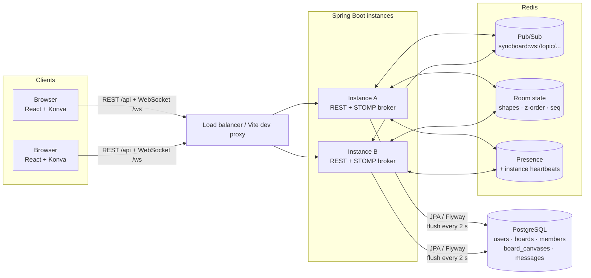
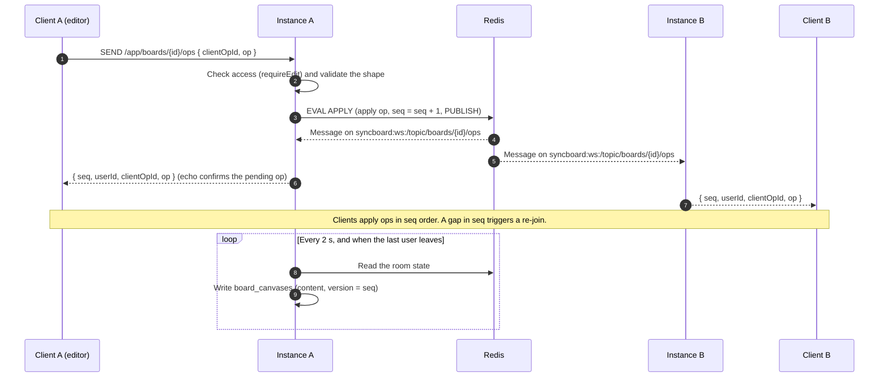

# SyncBoard

**English** | [한국어](README.ko.md)

SyncBoard is a real-time collaborative whiteboard. Several people can draw on the same board at once. Everyone sees each other's changes and cursors live, and the board has its own chat. A board can be shared as **editor** or **viewer**, and one board can be served by several backend instances, kept in sync through Redis.

<!-- TODO: replace with the live demo URL -->
**Live demo:** _coming soon_

## Screenshots

<!-- TODO: add screenshots to docs/screenshots/ and uncomment the lines below -->
<!--


-->

_Screenshots coming soon._

## Features

- **Accounts:** register and log in; the session uses a JWT access token.
- **Boards and sharing:** create, rename and delete boards. Invite existing users by email as `EDITOR` or `VIEWER`, change their roles, remove them, or leave a board yourself. The dashboard lists your own boards and the ones shared with you.
- **Drawing tools:** select/move, pen, rectangle, ellipse, line, text and eraser, with stroke color and width. **Undo** is per user and never reverts other people's work.
- **Real-time sync:** changes reach everyone within milliseconds. The server orders all changes, so every client ends up with the same drawing, and edits made while offline are re-sent on reconnect.
- **Presence and live cursors:** see who is online, each person in a stable color, and everyone's cursors on the canvas.
- **Chat:** a chat for each board with history, a "typing…" indicator and an unread counter. Viewers can chat too.
- **Pan and zoom:** zoom between 10% and 400% with the wheel, a trackpad pinch or the zoom controls. Pan with Space+drag or the middle mouse button. "Fit to content" shows the whole drawing.
- **PNG export:** download the whole drawing as an image, the same at any zoom level.
- **Two languages:** English and Korean UI. API error messages also come in both languages.
- **Horizontal scaling:** run several backend instances behind a load balancer, with no sticky sessions needed.

## Architecture

The frontend talks to the backend over REST (`/api`) for accounts, boards, members and chat history. A STOMP WebSocket (`/ws`) carries everything real-time.

Each backend instance serves its own WebSocket clients. All shared real-time state lives in **Redis**:

- live rooms (shapes, z-order and `seq`);
- presence lists;
- instance heartbeats.

Every broadcast goes through Redis Pub/Sub, so a client connected to instance A sees changes made through instance B. **PostgreSQL** is the permanent store. Live rooms are written back to it every 2 s, and when the last user leaves.



### How a drawing change travels

Each change (an `add`, `update` or `remove` op) carries the complete new shape, which makes ops idempotent. A Redis Lua script applies the op to the room, gives it the next `seq` number and publishes it in one atomic step. That way every instance receives ops in the same order. Each client keeps one op in flight. The client shows its own pending ops on top of the confirmed state, and the echo confirms them.



On (re)connect, the client subscribes to `/app/boards/{id}/join`. The reply contains the current snapshot with its `seq`, the online list and the latest chat messages, and the client then re-sends any pending ops. If an instance dies, its heartbeat key in Redis expires, and the other instances remove its users from the presence lists.

## Tech stack

| Area | Technologies |
| --- | --- |
| Backend | Java 21, Spring Boot 3.5, Spring Web, Spring WebSocket (STOMP, simple broker), Spring Security + OAuth2 Resource Server (JWT, HS256, Nimbus), Spring Data JPA, Bean Validation, Maven |
| Data | PostgreSQL, Flyway migrations, Redis (Pub/Sub, Lua scripts, room state, presence) |
| Frontend | React 19, TypeScript, Vite, React Router, Tailwind CSS v4, Konva + react-konva, @stomp/stompjs, i18next + react-i18next |
| Testing and tooling | JUnit 5 + Spring Boot Test (real PostgreSQL and Redis, STOMP test client), Vitest + Testing Library + jsdom, oxlint |

## Running locally

### Prerequisites

- **JDK 21**
- **Node.js 22** (Node 20.19+ also works with Vite)
- **PostgreSQL**
- **Redis.** On Windows, run it in WSL:

  ```bash
  sudo apt install redis-server
  sudo systemctl enable --now redis-server
  redis-cli ping   # PONG
  ```

### 1. Create the databases

Flyway creates the tables but not the databases:

```bash
createdb -U postgres syncboard
createdb -U postgres syncboard_test   # used by the tests
```

### 2. Configure the backend

```bash
cd backend
cp .env.example .env
```

Fill in `backend/.env` (Java `.properties` format, no quotes). At minimum, set `DB_PASSWORD` and `JWT_SECRET`. The secret must be at least 32 bytes, and you can generate one like this:

```bash
openssl rand -base64 48                                              # Bash
[Convert]::ToBase64String((1..48 | % { Get-Random -Max 256 }))      # PowerShell
```

| Variable | Default / example | Purpose |
| --- | --- | --- |
| `DB_URL` | `jdbc:postgresql://localhost:5432/syncboard` | App database |
| `DB_USERNAME` / `DB_PASSWORD` | `postgres` / — | Database credentials |
| `TEST_DB_URL` | `jdbc:postgresql://localhost:5432/syncboard_test` | Test database |
| `REDIS_URL` | `redis://localhost:6379` | Redis for the app |
| `REDIS_TEST_URL` | `redis://localhost:6379/1` | Redis for the tests |
| `JWT_SECRET` | — | HS256 signing key, ≥ 32 bytes |
| `JWT_TTL` | `PT1H` | Access token lifetime (ISO-8601) |
| `CORS_ALLOWED_ORIGINS` | `http://localhost:5173` | Allowed frontend origins |

Real environment variables override `.env`. The file is loaded relative to the working directory, so always run Maven from `backend/`.

### 3. Start the backend

```bash
cd backend
./mvnw spring-boot:run        # Windows PowerShell: .\mvnw.cmd spring-boot:run
```

The API runs on <http://localhost:8080>. Flyway applies the migrations on startup.

### 4. Start the frontend

```bash
cd frontend
npm install
npm run dev
```

Open <http://localhost:5173>. The Vite dev server proxies `/api` and `/ws` to `localhost:8080`.

### Running several backend instances (optional)

Start a second instance on another port against the same PostgreSQL and Redis:

```bash
./mvnw spring-boot:run -Dspring-boot.run.arguments=--server.port=8081
```

Clients connected to different instances see each other's drawing, cursors, presence and chat.

## Tests

### Backend

The tests use the real `syncboard_test` database and Redis (database `/1`, key prefix `syncboard-test`), so both must be running. There is no Testcontainers or Docker. Real-time tests connect a real STOMP client to a server on a random port, and `MultiInstanceIntegrationTest` starts a second instance next to the test context.

```bash
cd backend
./mvnw test                                   # all tests
./mvnw test -Dtest=AuthServiceTest            # one class
./mvnw test -Dtest=AuthServiceTest#loginWithWrongPasswordFailsWithoutIssuingToken   # one method
```

### Frontend

Tests run in jsdom. The WebSocket connection and Konva are replaced with mocks, and `fetch` is stubbed.

```bash
cd frontend
npm test                                      # Vitest, single run (npm run test:watch for watch mode)
npx vitest run src/pages/LoginPage.test.tsx   # one file; add -t "<test name>" for one test
npm run lint                                  # oxlint
npm run build                                 # type check + production build
```

## Project structure

```text
syncboard/
├── backend/                     Spring Boot API (com.syncboard)
│   └── src/main/
│       ├── java/com/syncboard/
│       │   ├── auth/            register, login, JWT
│       │   ├── user/
│       │   ├── board/           boards, members, access checks
│       │   ├── chat/            chat messages and history
│       │   ├── realtime/        STOMP, rooms, presence, Redis bus
│       │   ├── config/
│       │   └── common/          error handling
│       └── resources/
│           ├── db/migration/    Flyway migrations
│           └── messages*.properties
└── frontend/                    Vite + React app
    └── src/
        ├── api/                 apiFetch (the only fetch caller)
        ├── auth/                session, route guards
        ├── canvas/              shapes, ops, sync, viewport, export
        ├── chat/
        ├── realtime/            STOMP connection, useBoardRoom
        ├── components/
        ├── pages/
        └── i18n/                en / ko
```

## License

<!-- TODO: choose a license and add a LICENSE file -->
_Not specified yet._
